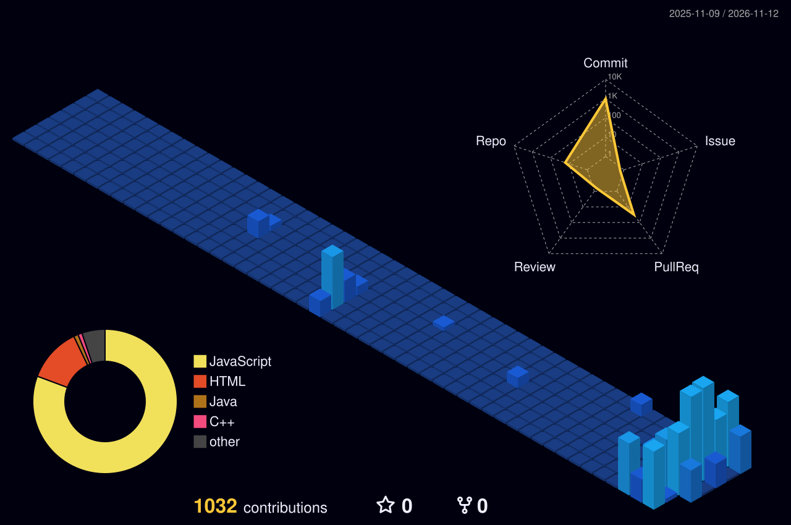

<!-- Rakibul Hasan Rakib | Original shinobi-inspired developer profile -->

  
  
  
  

## 🍥 Shinobi Profile

I'm a Computer Science and Engineering student at **International Islamic University Chittagong (IIUC)**. I enjoy building practical software, learning by shipping projects, and exploring how AI can solve real problems.

- 🥷 **Role:** CSE student and developer in training
- ⚔️ **Current focus:** Full-stack development, backend APIs, and problem-solving
- 🔥 **Exploring:** AI/ML and software engineering
- 🍃 **Philosophy:** Learn by building, test what you make, improve every iteration
- 📍 **Village:** Chattogram, Bangladesh

> "A shinobi never stops learning." — My coding mindset.

## 🌀 Jutsu Arsenal — Tech Stack

  

## 🪪 Shinobi ID & Mission Dashboard

  

## 📊 Live Mission Stats

  
  
  

## 🏯 S-Rank Missions — Featured Projects

| Mission | Brief | Repository |
|:--|:--|:--:|
| **CampusSathi AI** | AI-powered assistant helping university students solve everyday campus problems | [View mission ↗](https://github.com/rakibulhasanrakibofficial/campus-sathi-ai) |
| **Simple E-commerce Store** | Full-stack e-commerce application built as an internship task | [View mission ↗](https://github.com/rakibulhasanrakibofficial/CodeAlpha_SimpleEcommerce) |
| **Connectly — Social Platform** | Full-stack social media platform | [View mission ↗](https://github.com/rakibulhasanrakibofficial/CodeAlpha_SocialMediaPlatform) |
| **Blood Donor Management System** | Data Structures lab project | [View mission ↗](https://github.com/rakibulhasanrakibofficial/Blood-Donor-Management-System) |
| **University Complaint Routing System** | C++ and Qt 6 complaint management with department routing and status tracking | [View mission ↗](https://github.com/rakibulhasanrakibofficial/University-Complaint-Routing-System) |

<a href="https://github.com/rakibulhasanrakibofficial?tab=repositories"><strong>⚡ EXPLORE ALL REPOSITORIES →</strong></a>

## 🌃 The Hidden Village — Contribution City

  
    
  

## 🎯 Next Missions

- Strengthen data structures, algorithms, and problem-solving fundamentals
- Build reliable, maintainable full-stack applications
- Explore AI/ML through practical projects
- Learn from open source and contribute to meaningful projects

## 🤝 Join the Squad

  

**Keep training. Keep coding. Keep growing.** 🍥

