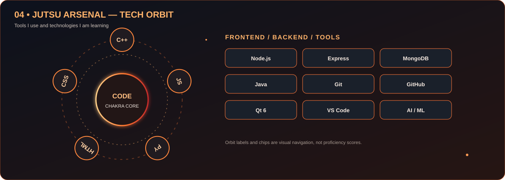
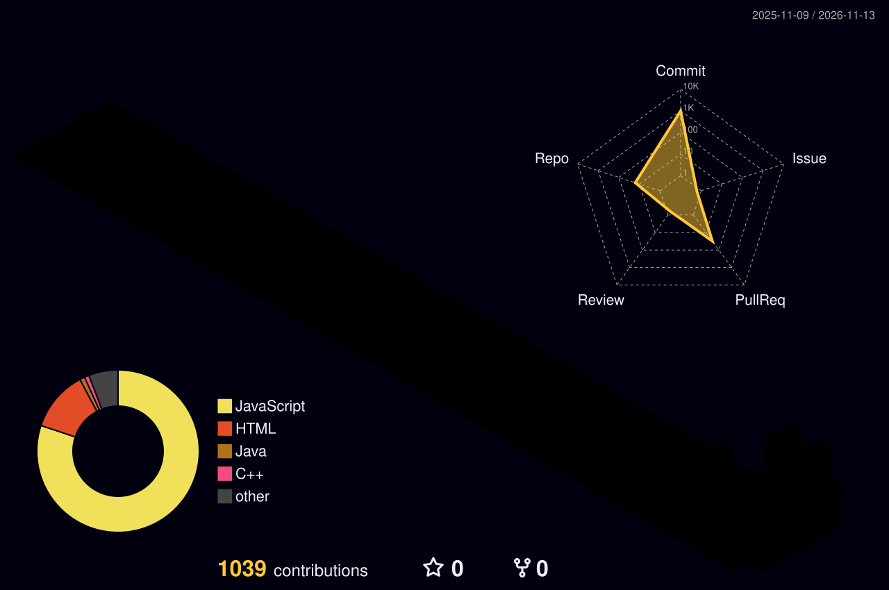
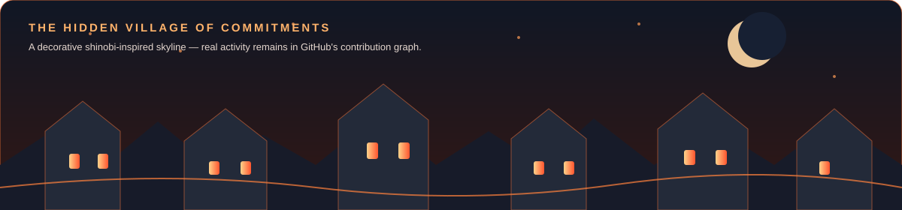

<!--
  SHINOBI DEVELOPER PROFILE
  Built for Rakibul Hasan Rakib.
  SVG motion is self-contained so GitHub can render it without JavaScript.
-->

  
  
  
  

**Learn · Build · Improve · Repeat**

---

## 🍥 SHINOBI PROFILE

I'm a Computer Science and Engineering student at **International Islamic University Chittagong (IIUC)**. I enjoy building practical software, learning through hands-on projects, and exploring how AI can solve real problems.

| | Mission details |
|:--|:--|
| 🥷 **Role** | CSE student and developer in training |
| ⚔️ **Current focus** | Full-stack development, backend APIs, and problem-solving |
| 🔥 **Exploring** | AI/ML and practical software engineering |
| 📍 **Village** | Chattogram, Bangladesh |
| 🎯 **Mindset** | Learn by building, test what you make, improve every iteration |

> “A shinobi never stops learning.”

## ⚔️ WHAT I BUILD

## 🌀 JUTSU ARSENAL

## 🎴 OFF-DUTY SIDE QUESTS

## 🪪 SHINOBI ID + MISSION DASHBOARD

## 📊 LIVE GITHUB DASHBOARD

## 🏯 S-RANK MISSIONS — FEATURED PROJECTS

| Mission | What it does | Repository |
|:--|:--|:--:|
| **CampusSathi AI** | AI-powered assistant for university students | [Explore ↗](https://github.com/rakibulhasanrakibofficial/campus-sathi-ai) |
| **Simple E-commerce Store** | Full-stack e-commerce internship project | [Explore ↗](https://github.com/rakibulhasanrakibofficial/CodeAlpha_SimpleEcommerce) |
| **Connectly — Social Platform** | Full-stack social media platform | [Explore ↗](https://github.com/rakibulhasanrakibofficial/CodeAlpha_SocialMediaPlatform) |
| **Blood Donor Management System** | Data Structures lab project | [Explore ↗](https://github.com/rakibulhasanrakibofficial/Blood-Donor-Management-System) |
| **University Complaint Routing System** | Complaint routing and status tracking with C++ / Qt 6 | [Explore ↗](https://github.com/rakibulhasanrakibofficial/University-Complaint-Routing-System) |

[**VIEW ALL MISSIONS →**](https://github.com/rakibulhasanrakibofficial?tab=repositories)

## 🌃 MY CONTRIBUTION VILLAGE

*Every commit raises another building, rebuilt automatically every day.*

> If the 3D village is not visible yet, open the repository's **Actions** tab and run **Generate 3D Contribution City** once. The workflow will publish the generated SVG.

## 🤝 CONNECT WITH THIS SHINOBI

  

**Train your skills. Build your legacy.** 🍥

