<!-- Profile README · Rakibul Hasan Rakib -->

  

  

    
    
    
  

---

## 👋 About Me

I'm a Computer Science and Engineering student at **International Islamic University Chittagong (IIUC)**. I enjoy building useful software, learning through hands-on projects, and improving my problem-solving skills.

- 💻 **Focus:** Full-stack development, backend APIs, and practical software
- 🧠 **Interests:** AI/ML, software engineering, and problem-solving
- 🌱 **Learning:** Strengthening fundamentals by building and shipping projects
- 🤝 **Open to:** Meaningful collaborations, open-source learning, and constructive feedback

## 🧰 Tech Stack

  
  
  
  
  
  
  
  
  
  
  

## 🚀 Selected Projects

**🧭 [CampusSathi AI](https://github.com/rakibulhasanrakibofficial/campus-sathi-ai)**  
A campus-focused AI assistant project exploring practical support for students.

**🛍️ [Simple E-commerce Store](https://github.com/rakibulhasanrakibofficial/CodeAlpha_SimpleEcommerce)**  
A full-stack store project with product browsing and shopping-cart functionality.

**💬 [Social Media Platform](https://github.com/rakibulhasanrakibofficial/CodeAlpha_SocialMediaPlatform)**  
A backend-focused project exploring user accounts and core social-platform features.

**🩸 [Blood Donor Management System](https://github.com/rakibulhasanrakibofficial/Blood-Donor-Management-System)**  
A project focused on organizing donor information for blood-donation management.

**🏫 [University Complaint Routing System](https://github.com/rakibulhasanrakibofficial/University-Complaint-Routing-System)**  
A university-oriented project focused on routing and managing complaints.

[Explore all repositories →](https://github.com/rakibulhasanrakibofficial?tab=repositories)

## 📊 GitHub Snapshot

  
   
  

## 🎯 What I'm Building Toward

- Stronger problem-solving and data-structure fundamentals
- Reliable, maintainable full-stack applications
- Practical AI/ML projects and open-source contributions

## 🤝 Let's Connect

Have a project idea or a collaboration in mind? Feel free to reach out.

- 📧 **Email:** [rakibhasan2569@gmail.com](mailto:rakibhasan2569@gmail.com)
- 💼 **LinkedIn:** [rakibul-hasan-rakib](https://www.linkedin.com/in/rakibul-hasan-rakib-a0b4aa435/)
- 🐙 **GitHub:** [@rakibulhasanrakibofficial](https://github.com/rakibulhasanrakibofficial)

  
<em>“Stay curious. Build with purpose. Keep getting better.”</em>

  

