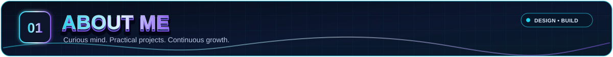
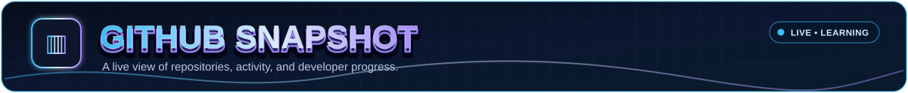
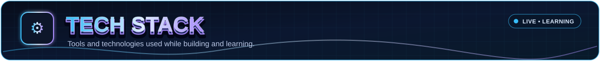
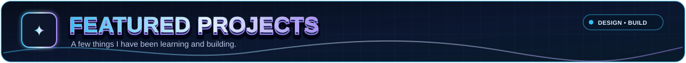
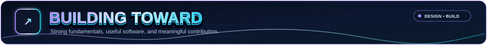

<!-- Rakibul Hasan Rakib | Neon developer portfolio | Mobile-first layout -->

  

  

    
    
    
    
  

---

I'm a Computer Science and Engineering student at **International Islamic University Chittagong (IIUC)**. I enjoy building practical software, learning through hands-on projects, and solving real problems with code.

- 💻 **Focus:** Full-stack development, backend APIs, and useful applications
- 🧠 **Interests:** AI/ML, software engineering, and problem-solving
- 🌱 **Approach:** Learn by building, testing, and improving projects
- 🤝 **Community:** Interested in open-source learning and meaningful collaboration

<strong>📍 Chattogram, Bangladesh &nbsp;·&nbsp; 🎓 CSE student at IIUC</strong>

---

  

  

---

  

---

[**EXPLORE ALL REPOSITORIES →**](https://github.com/rakibulhasanrakibofficial?tab=repositories)

---

- 🎯 Strengthen problem-solving and data-structure fundamentals
- 🧩 Build reliable, maintainable full-stack applications
- 🤖 Explore AI/ML through practical projects
- 🌍 Learn from open source and contribute where I can
- 📚 Develop research skills and keep learning consistently

   
  <strong>STAY CURIOUS · BUILD WITH PURPOSE · KEEP GETTING BETTER</strong>
    
  

