<!--
  ANIMATED GITHUB PROFILE — midnight glass + aurora edition
  Built for Rakibul Hasan Rakib. All cards are self-contained animated SVGs
  (CSS + SMIL only — GitHub strips JavaScript from READMEs).
  If you edit an SVG and the profile looks unchanged, GitHub's image cache is
  stale: bump ?v=1 to ?v=2 in the image links below, commit the SVG first,
  then this README.
-->

  
  
  
  

**Learn · Build · Improve · Repeat**

---

## 🌙 ABOUT — MY WAY & OFF DUTY

## 🛰️ TECH ORBIT

## 🪪 ID BADGE + MISSION DASHBOARD

## 🚀 FEATURED PROJECTS

| Project | What it does | Repository |
|:--|:--|:--:|
| **PayGuard** | AI-powered invoice management & payment scam-risk protection for freelancers | [Explore ↗](https://github.com/rakibulhasanrakibofficial/PayGuard) |
| **Shonket AI** | Bangladesh-focused AI scam intelligence & digital safety platform | [Explore ↗](https://github.com/rakibulhasanrakibofficial/shonket-ai) |
| **CampusSathi AI** | AI assistant helping university students solve everyday campus problems | [Explore ↗](https://github.com/rakibulhasanrakibofficial/campus-sathi-ai) |
| **Connectly** | Full-stack social media platform (CodeAlpha internship) | [Explore ↗](https://github.com/rakibulhasanrakibofficial/CodeAlpha_SocialMediaPlatform) |
| **TaskFlow** | Full-stack project management tool (CodeAlpha internship) | [Explore ↗](https://github.com/rakibulhasanrakibofficial/CodeAlpha_ProjectManagementTool) |
| **Simple E-commerce** | Full-stack e-commerce store (CodeAlpha internship) | [Explore ↗](https://github.com/rakibulhasanrakibofficial/CodeAlpha_SimpleEcommerce) |
| **University Complaint Routing** | Complaint routing & status tracking with C++ / Qt 6, PDF export | [Explore ↗](https://github.com/rakibulhasanrakibofficial/University-Complaint-Routing-System) |
| **Blood Donor Management** | Data Structures lab project in C++ | [Explore ↗](https://github.com/rakibulhasanrakibofficial/Blood-Donor-Management-System) |

[**VIEW ALL 16 REPOSITORIES →**](https://github.com/rakibulhasanrakibofficial?tab=repositories)

## 🌃 MY CONTRIBUTION VILLAGE

*Every commit raises another building — rebuilt automatically every day.*

> If the 3D village is not visible yet, open the repository's **Actions** tab and run **Generate 3D Contribution City** once — it refreshes itself daily after that.

## 🤝 CONNECT

  

**Build your legacy, one commit at a time.** 🌙

